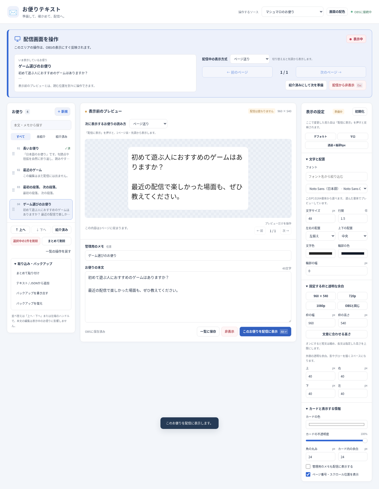

# jp-letters

日本語テキスト→マシュマロ対応へ。

マシュマロ読み配信などのお便りを、準備・プレビュー・配信への表示・ページ切り替えまで扱うOBS用ソースです。LuaとOBS内蔵ブラウザを使用し、PythonやNode.jsの追加インストールは不要です。

## 試す

[0.3.3の配布ZIP](releases/v0.3.3/jp-letters-0.3.3.zip)をダウンロードして展開し、OBSの「ツール → スクリプト」で `jp-letters.lua` を追加してください。ソース追加から「日本語お便りテキスト（マシュマロ向け）」を選びます。

0.3.1で、ソースが残った状態でスクリプトを削除・再読み込みするとOBSが終了する不具合を修正しました。旧版からの更新は、OBSを終了した状態で既存フォルダの `jp-letters.lua` と `runtime`・`web` を上書きします。修正前のスクリプトをOBSの画面で削除する必要はありません。

リポジトリから使う場合は `letters/jp-letters.lua` を追加し、`letters/runtime` と `letters/web` も一緒に保管します。

[導入・旧版からの更新・使い方](letters/README.md) · [初回版の記録](docs/baseline-v0.2.0.md) · [タスクの順番](docs/roadmap.md) · [規約と配色の調査](docs/research-2026-10-09.md)

OBS 30.2以降を対象とします。同じ配布ファイルをMac・Windowsで使う構成です。Linuxの実際のOBS LuaとChromiumで検証していますが、Mac・WindowsのOBS実機での検証はまだ行っていません。

現在は本文貼り付け・テキスト・JSON取り込みに対応します。マシュマロ受信箱へのログインや自動取得は含みません。本プロジェクトはマシュマロの公式ツールではありません。

## 0.3.3の改善

一覧下の **「まとめて削除」** で、選んだお便り・紹介済み・一覧のすべてを削除できます。確認画面で件数と本文を見てから実行し、配信中の表示と表示設定は保ちます。**「一覧の操作を戻す」1回** で一括削除の全件を戻せます。

[使い方と検証の記録](docs/validation-v0.3.3.md)

## 0.3.2の改善

上部を **「配信画面を操作」** のパネルにし、表示中のお便り・ページ・スクロール位置を見分けやすくしました。表示方式は配信操作とプレビューの近くに置いています。

- 配信中の操作はOBSへすぐ反映します。方式を変えると、そのお便りだけを先頭へ戻します。
- 表示前プレビューは次のお便りの確認用です。「配信は変わりません」と明記し、読む位置と設定を独立して保ちます。

[改善と検証の記録](docs/validation-v0.3.2.md)

## 0.3.0からの機能

- フォントの一覧・検索・プレビューの即時反映
- 「一覧に保存」「非表示」「配信に表示」の操作とOSごとのキー表記
- 不透明度100%のスライダー、表示設定の初期化と3つの配色
- 枠960×540を維持し、720p・1080p・OBSキャンバスのボタンを追加
- 短文を縮め、長文は最大高さにする自動調整
- ページ方式に加え、全文を手動でスクロールして読むモード
- 現行ブルーに加え4つのパステル配色・カスタム・全設定バックアップ

自分が受信した本文の再利用については公式ヘルプに根拠があります。URLの自動取得の許諾と公式APIはまだ確認できておらず、[Issue #8](https://github.com/hekiruligames/jp-letters/issues/8)へ調査結果を残します。

Safariの追加フォント制限に対応するため、選んだ書体をPC内だけでWebフォントとして読み込みます。埋め込みが制限された書体等は通常のPC内フォント表示へ戻し、案内を表示します。フォントのファイルは配布物やバックアップに同梱しません。

## 開発

- `letters/jp-letters.lua`: OBSソースと設定保存・ホットキー
- `letters/runtime/http.lua`: PC内の操作画面への接続
- `letters/web/`: 操作画面と日本語テキスト描画
- `tests/`: OBS LuaとChromiumの検証
- `tools/package-letters.py`: 配布ZIPの生成

GPL-2.0-or-later。ソースは配布物にも同梱します。
