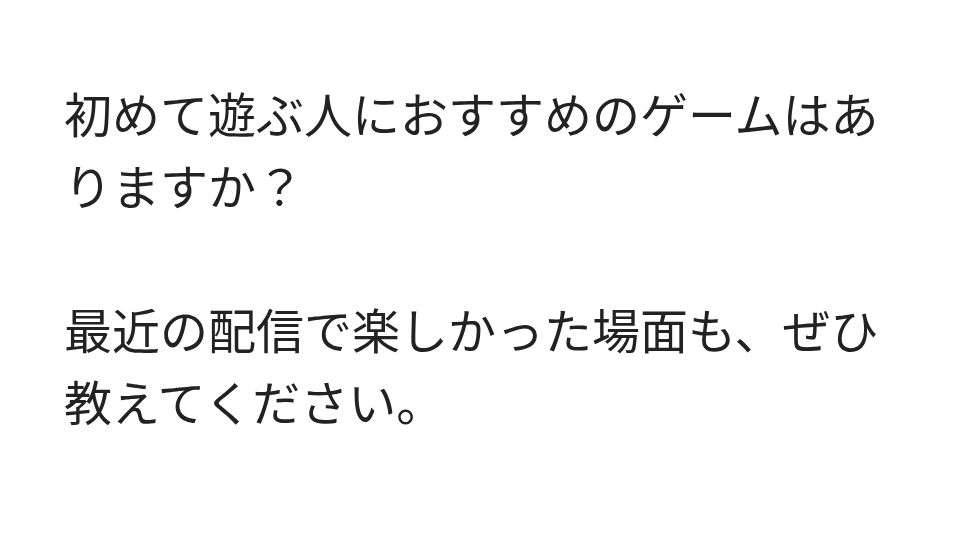

# jp-letters-lua

マシュマロなどのお便りを、OBSの配信画面に表示するツールです。

本文を貼り付け、プレビューで見た目を確認してから、ボタンひとつでOBSに表示できます。ひとつのお便りを表示したまま、次のお便りを準備できます。

- 長いお便りは、ページ送りや手動スクロールで読み進められます。
- フォント・文字の大きさ・カードの色・余白などを調整できます。
- お便りを一覧に保存し、管理用のメモを付けて、配信前に準備できます。
- コピーした受信箱のお便りを、内容を確認・編集してから一括登録できます。

**[試作版 v0.4.0 をダウンロードする（ZIP）](https://github.com/hekiruligames/jp-letters-lua/releases/download/v0.4.0/jp-letters-0.4.0.zip)**

配信に表示されるお便りカードの例です。



本プロジェクトはマシュマロの非公式ツールです。受信した本文を自分で貼り付けて使います。テキストファイル・JSONの取り込みにも対応していますが、受信箱へのログインや、お便りの自動取得には対応していません。

## はじめて使う：OBSにお便りを表示するまで

OBS 30.2以降を用意してください。操作画面は、OBSと同じPCのChrome・Edge・Safariなどで開きます。PythonやNode.jsの追加インストールは不要です。

Windows・macOSで同じZIPを使う設計の試作版です。LinuxのOBSとChromiumで検証していますが、Windows・macOSのOBS実機での検証はまだ行っていません。

### 1. ZIPを展開し、フォルダごと保管する

上のリンクからZIPをダウンロードして展開します。中にある `jp-letters.lua` と、`runtime`・`web` フォルダを、まとめて使い続ける場所に置いてください。たとえば「ドキュメント」の中に保管できます。

`jp-letters.lua` の隣に `runtime` と `web` がある状態を保ちます。OBSに登録した後も、このフォルダを残しておいてください。移動するとOBSから読み込めなくなります。

### 2. OBSにスクリプトを追加する

OBSを開き、メニューの **「ツール → スクリプト」** を選びます。その画面の **「＋」** を押して、手順1で保管した **`jp-letters.lua`** を選びます。

### 3. シーンにお便りのソースを追加する

お便りを表示したいシーンを選び、OBSの **「ソース」欄の「＋」** を押します。

**「日本語お便りテキスト（マシュマロ向け）」** を選び、名前を付けて作成してください。

この時点では、お便りはまだ表示されません。手順5で表示ボタンを押すと、OBSのプレビューに現れます。

### 4. お便りの操作画面を開く

ソースのプロパティで **「お便りの操作画面を開く」** を押します。ブラウザで操作画面が開いたら、OBSのプロパティは **「OK」** で閉じてください。

プロパティを閉じてしまった場合は、OBSの「ソース」欄で、作成したソースの名前をダブルクリックすると開けます。

### 5. 本文を貼り付け、OBSに表示する

操作画面の **「お便りの本文」** に、表示したい文章を貼り付けます。まずは次の文章で試せます。

```text
いつも配信を楽しく見ています！
最近おすすめのゲームはありますか？
```

**「表示前のプレビュー」** で見た目を確認し、**「このお便りを配信に表示」** を押してください。OBSのプレビューに文章が表示されたら、導入は完了です。配信を開始せずに確認できます。

表示位置と大きさは、OBSのプレビュー上で調整できます。

## 配信中のお便りを操作する

操作画面には、配信中のお便りを操作する場所と、次のお便りを準備する場所があります。

| 場所 | できること | OBSの表示への反映 |
| --- | --- | --- |
| 上部の「配信画面を操作」 | 表示中のお便りのページ送り・スクロール | すぐ反映します。 |
| 「表示前のプレビュー」と本文・表示設定 | 次に表示するお便りの編集と確認 | 「このお便りを配信に表示」を押すと反映します。 |

長文を表示したら、上部の **「配信中の表示方式」** で「ページ送り」か「スクロール」を選びます。その近くのボタンやスライダーで、配信に出ている文章を読み進めてください。表示方式を切り替えると、先頭に戻ります。

お便りを画面から消すときは、上部の **「配信から非表示」** を押します。


## 配信前に準備して、あとで続きを使う

本文や管理用のメモを入力したら、**「一覧に保存」** を押してください。お便りはOBSに保存されます。操作画面に「OBSに保存済み」と表示されたことを確認してから、ブラウザを閉じられます。

OBSを再起動した後は、手順4の **「お便りの操作画面を開く」** から開き直してください。保存したお便りや設定を使って、準備を続けられます。

バックアップは、操作画面の **「取り込み・バックアップ → バックアップを書き出す」** から保存できます。保存・削除・フォント設定などの詳しい操作は、[使い方ガイド](letters/README.md#使い方)にまとめています。

## 受信箱のお便りをまとめて準備する（0.4.0で追加）

マシュマロで **「受信箱 → もらったメッセージ → 未確認」** を開きます。個別のお便りはクリックせず、一覧の外の灰色の余白をクリックしてください。Macは **⌘A → ⌘C**、Windowsは **Ctrl＋A → Ctrl＋C** でページ全体をコピーします。

jp-lettersの操作画面の左にある **「受信箱から取り込む」** を押し、貼り付けて **「内容を確認」** へ進んでください。

候補の本文・改行・件数を確認し、必要なものにチェックして **「○件を一覧に登録」** を押します。**「重複以外を選ぶ」** でまとめて選ぶこともできます。保存が終わると確認画面が閉じ、一覧から配信の準備を続けられます。

Safariでコピーした未確認一覧の実データ2件で、本文の抽出を確認しました。判別できない形式は原文を残して手動で編集・分割できます。Mac・WindowsのOBS実機での確認は継続中です。[詳しい手順](letters/README.md#お便りの登録と取り込み)をご覧ください。

## 旧版を使っている方へ

更新する前にバックアップを書き出し、OBSを終了してください。その後、既存フォルダの `jp-letters.lua` と `runtime`・`web` を、新しいZIPのファイルでまとめて上書きします。

0.2.0・0.3.0では、OBSを起動したままスクリプトを削除・再読み込みすると、OBSが終了する不具合があります。更新はOBSを終了してから行ってください。[旧版からの更新手順](letters/README.md#旧版から更新する)

<details>
<summary>ソースコードから使う場合・開発や移行の記録</summary>

このリポジトリをダウンロードして使う場合は、OBSに `letters/jp-letters.lua` を追加します。`letters/runtime` と `letters/web` も一緒に保管してください。

お便り版は2026-10-09に `hekiruligames/jp-letters` から移行しました。開発・Issue・配布はこのリポジトリで管理します。初期のC++ネイティブプラグインは含みません。スクリプト名・OBSソースのID・保存形式・配布ZIP・GPL-2.0-or-laterのライセンスを引き継いでいます。

[移行の記録](docs/repository-migration.md) · [初回版の記録](docs/baseline-v0.2.0.md) · [タスクの順番](docs/roadmap.md) · [規約と配色の調査](docs/research-2026-10-09.md)

</details>

## 0.4.0の改善

コピーした受信箱と、区切って貼り付けた本文を、確認・編集・選択してから一括登録できるようにしました。判別できない形式では原文を保持します。配信中の表示を保ち、追加を1回で取り消せます。

[使い方と検証の記録](docs/validation-v0.4.0.md)

## 0.3.3の改善

一覧下の **「まとめて削除」** で、選んだお便り・紹介済み・一覧のすべてを削除できます。確認画面で件数と本文を見てから実行し、配信中の表示と表示設定は保ちます。**「一覧の操作を戻す」1回** で一括削除の全件を戻せます。

[使い方と検証の記録](docs/validation-v0.3.3.md)

## 0.3.2の改善

上部を **「配信画面を操作」** のパネルにし、表示中のお便り・ページ・スクロール位置を見分けやすくしました。表示方式は配信操作とプレビューの近くに置いています。

- 配信中の操作はOBSへすぐ反映します。方式を変えると、そのお便りだけを先頭へ戻します。
- 表示前プレビューは次のお便りの確認用です。「配信は変わりません」と明記し、読む位置と設定を独立して保ちます。

[改善と検証の記録](docs/validation-v0.3.2.md)

## 0.3.0からの機能

- フォントの一覧・検索・プレビューの即時反映
- 「一覧に保存」「非表示」「配信に表示」の操作とOSごとのキー表記
- 不透明度100%のスライダー、表示設定の初期化と3つの配色
- 枠960×540を維持し、720p・1080p・OBSキャンバスのボタンを追加
- 短文を縮め、長文は最大高さにする自動調整
- ページ方式に加え、全文を手動でスクロールして読むモード
- 現行ブルーに加え4つのパステル配色・カスタム・全設定バックアップ

自分が受信した本文の再利用については公式ヘルプに根拠があります。URLの自動取得の許諾と公式APIはまだ確認できておらず、[Issue #8](https://github.com/hekiruligames/jp-letters-lua/issues/8)へ調査結果を残します。

Safariの追加フォント制限に対応するため、選んだ書体をPC内だけでWebフォントとして読み込みます。埋め込みが制限された書体等は通常のPC内フォント表示へ戻し、案内を表示します。フォントのファイルは配布物やバックアップに同梱しません。

## 開発

- `letters/jp-letters.lua`: OBSソースと設定保存・ホットキー
- `letters/runtime/http.lua`: PC内の操作画面への接続
- `letters/web/`: 操作画面と日本語テキスト描画
- `tests/`: OBS LuaとChromiumの検証
- `tools/package-letters.py`: 配布ZIPの生成

ReleaseへのZIP添付は、GitHub Actionsの **Attach release ZIP** からタグと検証済みSHA-256を指定して実行します。ジョブ用の認証で添付し、ダウンロードしたファイルまで照合します。[公開担当者向けの手順](docs/release-attachment.md)。

GPL-2.0-or-later。ソースは配布物にも同梱します。
