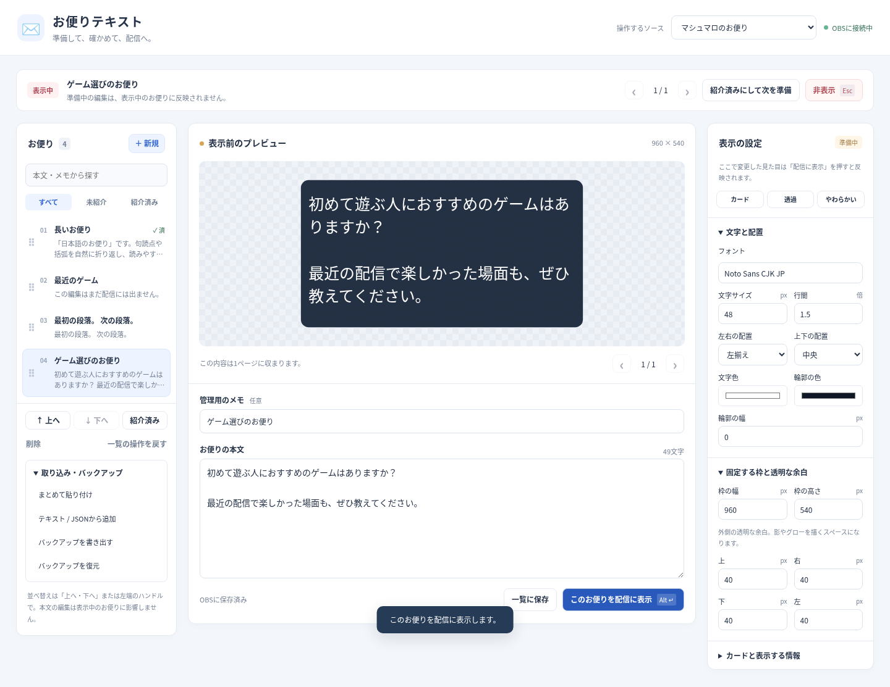

# 0.2.0 初回動作版の記録

記録日: 2026-10-09（日本時間）。GitHubで改善を始める前に、初回版をそのまま保存する。

- 配布物: [jp-letters-0.2.0.zip](../releases/v0.2.0/jp-letters-0.2.0.zip)
- ソース: `letters/`。Luaの独自OBSソースと内蔵ブラウザ描画を組み合わせる。
- 準備と配信中の本文・見た目は別のスナップショット。表示ボタンで反映する。
- 長文をフォントと行間を保ってページ分けする。
- 既定の枠は960×540、外側の透明余白は各40px、文字48px、行間1.5。
- 本文貼り付け、テキスト・JSON取り込み、並べ替え、紹介済み、バックアップ、OBSホットキーを備える。
- 初期フォントはWindowsでYu Gothic、MacでYuGothic。
- メッセージの自動取得やURL取り込みは未実装。

## 検証

Linuxのlibobs 30.2.3の実際のLuaJITで登録・保存復元・ホットキー・子ソース解放を確認。操作と日本語描画はChromiumで確認し、Web側11項目とネイティブ側3項目が通過した。PNGの四辺40pxのアルファ値が0であることも確認。

ネイティブ検証のブラウザ子ソースはテスト用描画ソースを使う。実際のOBSブラウザソースとの連携はこの環境では未確認。Mac・WindowsのOBS実機確認は未実施である。利用者はMacのOBSで初回版を起動し、追加の改善項目を報告している。

詳細と配布内のソースハッシュ: [validation-v0.2.0.json](validation-v0.2.0.json)。動的な接続トークン、テスト時のOBSシーン、個人のお便りは記録に含めない。

## 配布物のSHA-256

`ad066c82ccbd3b72b064c7a1fdec53d793a0aed600804b654158f13da8ecf283`

