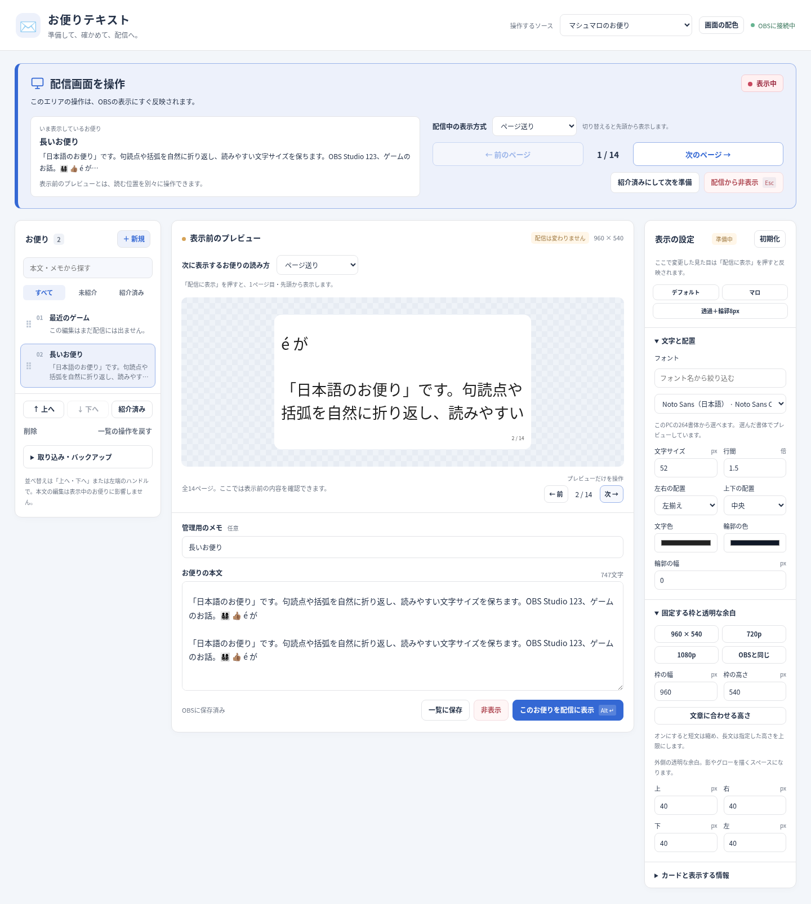
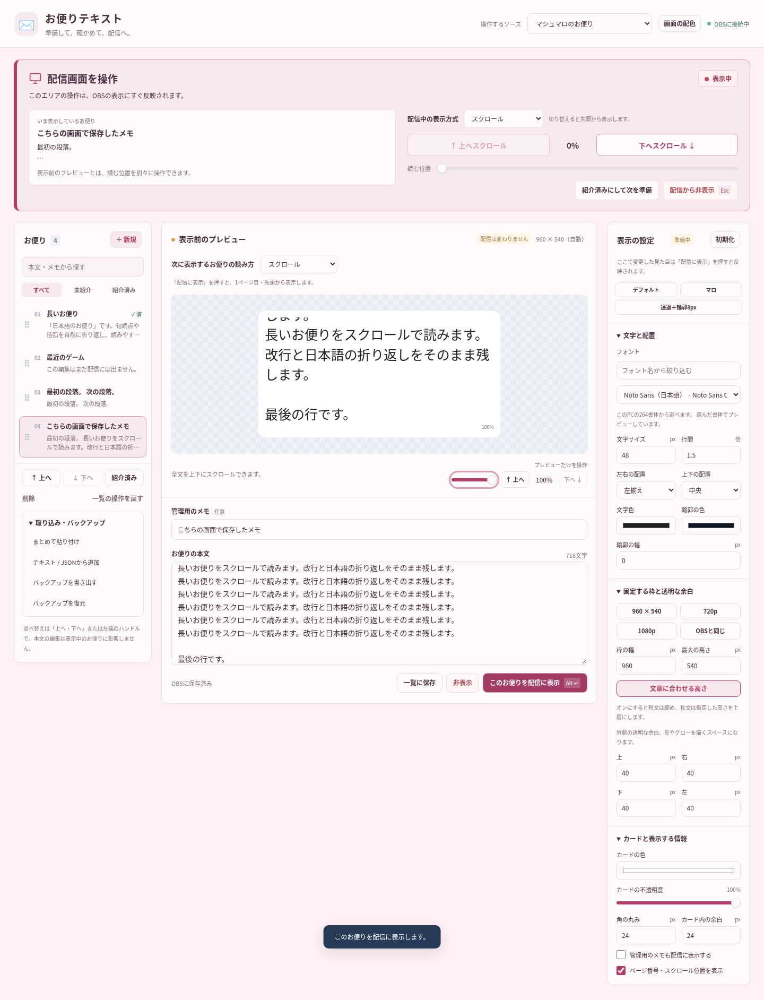

# 0.3.2: 配信中の操作と表示前プレビューを見分けやすくする

2026-10-09（日本時間）。プレビューのページ送りを配信画面への操作と取り違えたフィードバックを受け、[#13](https://github.com/hekiruligames/jp-letters/issues/13)で追跡した。

## 画面と操作

上部を「配信画面を操作」という大きなパネルに変更した。画面の配色に合わせた背景・左の太線・モニターのアイコンを使用し、表示状態、現在のお便りのタイトルと本文の冒頭、ページ数またはスクロール位置を表示する。「このエリアの操作は、OBSの表示にすぐ反映されます。」と明記し、前／次のボタンも操作名付きにした。

プレビューには「配信は変わりません」「プレビューだけを操作」を表示する。表示方式は右側の設定下部からプレビュー上へ移し、「次に表示するお便りの読み方」と表示した。ここで準備した方式は「配信に表示」を押すと反映し、読む位置は1ページ目・先頭になる。

配信側にも、ページ・スクロールの操作と並べて「配信中の表示方式」を置いた。表示中のお便りだけを切り替え、先頭へ戻すことを選択欄の横に明記する。この操作は準備中の本文、一覧、準備用の表示設定を変更しない。カードの見た目と枠の寸法も保持する。

## 検証

Linux libobs 30.2.3の実OBS LuaJITと実Chromiumで、以下を含むWeb19項目、OBS Lua6項目、フォント制限5通りが通過した。

- プレビューの次のページでプレビューだけが移動し、配信中のスナップショットと実Chromiumの出力は保たれる。
- 配信の次のページは出力を切り替え、OBSホットキーでもページを戻せる。
- 準備中の方式だけを変更しても配信方式は変わらない。
- 配信中のページ／スクロール切り替えは表示中だけに反映し、本文・見た目・一覧・下書き・準備設定を保つ。切り替え後は先頭に戻る。
- スクロールのボタン、スライダー、OBSホットキーが末尾まで動作し、プレビューのスクロールは独立する。
- ブルー、4種類のパステル、カスタム配色の保存と、旧データの読み込みを維持する。
- 幅390・680・800・1100・1200・1440pxで横方向にはみ出さず、両方の方式選択を利用できる。
- 0.3.1のクラッシュ修正を保ち、アクティブなソースを残してスクリプト削除、再追加、3回の再読み込みを行っても終了せず、ホットキーと子ソースを適切に解放する。

製品ソースのSHA-256をテスト前後で照合し、配布ZIP生成時も照合した。[機械可読の結果](validation-v0.3.2.json)。テストは[`letters-e2e.mjs`](../tests/letters-e2e.mjs)と[`letters-integration.cpp`](../tests/letters-integration.cpp)に記録する。

Mac・WindowsのOBS実機とSafariでの確認は今回の開発環境では行っていない。ネイティブの子ブラウザはテスト用の描画ソースで代用し、HTMLを別の実Chromiumで検証している。実機確認は[#10](https://github.com/hekiruligames/jp-letters/issues/10)に残す。

## 更新

OBSを終了し、既存スクリプトの保存先へ `jp-letters.lua` と `runtime`・`web` を上書きする。OBSを起動し、OBSのボタンから操作画面を開き直す。0.2.0・0.3.0には削除時のクラッシュがあるため、旧スクリプトをOBSの画面で削除する操作は行わない。[詳細](../letters/README.md#旧版から更新する)。
