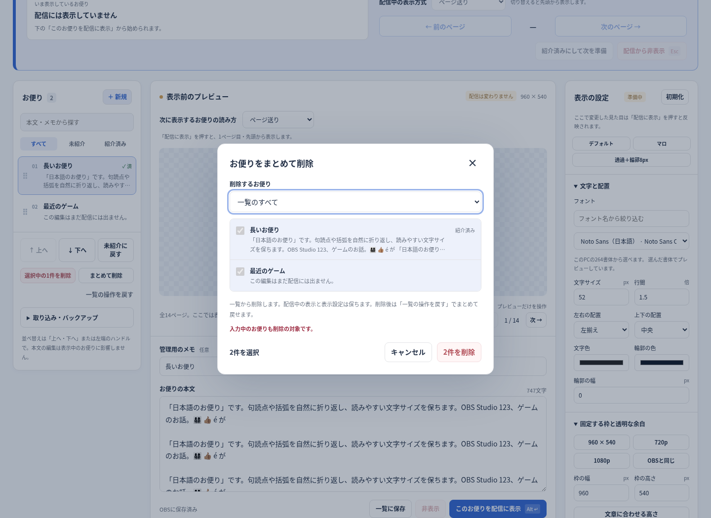

# 0.3.3: お便りをまとめて削除する

2026-10-09（日本時間）。利用者から一括削除の方法を尋ねられ、0.3.2には1件削除しかないことを確認した。[#15](https://github.com/hekiruligames/jp-letters/issues/15)で追跡する。

## 使い方

左のお便り一覧の下に **「まとめて削除」** を追加した。確認画面で対象を選び、件数と本文を確認して **「○件を削除」** を押す。

- 選んだお便り：チェックしたものだけを削除する。全選択と選択解除も用意した。
- 紹介済みのお便り：紹介済みのものだけを削除する。
- 一覧のすべて：登録された一覧を空にする。

1件削除も **「選択中の1件を削除」** と明記したボタンへ変更した。削除対象に入力中のお便りが含まれる場合、本文も消えることを確認画面に表示する。

削除しても配信中のお便り、表示設定、画面の配色を保つ。未登録の下書きと確認画面を開いた後に追加されたお便りは、削除対象へ自動で含めない。キャンセル・Escでは一覧も配信も変えない。一括削除を履歴の1操作として保存し、**「一覧の操作を戻す」1回** で全件を復元する。

## 検証

実Linux libobs 30.2.3＋OBS LuaJITと実Chromiumで、Web21項目、OBS Lua6項目、フォント制限5通りが通過した。

- 対象未選択では削除ボタンが無効になる。Escで閉じても配信中の表示は保たれる。
- 選んだ2件、紹介済みの1件、全4件をそれぞれ削除でき、1回の取り消しで一覧と入力中の本文を戻せる。
- 表示中のお便りを一覧から削除しても、実Chromiumの配信出力とネイティブ側の表示状態、表示設定・配色を保つ。
- 一覧に未登録の下書きを保持する。確認中に別の更新で1件追加しても、そのお便りは削除対象に含まれない。
- 幅390pxで確認画面が収まる。通常画面も幅390〜1440pxで横方向にはみ出さない。
- 従来のページ、スクロール、書体、バックアップ、保存・復元の動作を維持する。
- 0.3.1のクラッシュ修正を維持し、スクリプト削除、再追加、3回の再読み込みで子ソースとホットキーの後始末を確認した。

テスト前後と配布ZIPの製品ファイルのSHA-256を照合した。[機械可読の結果](validation-v0.3.3.json)。一括削除の検証は[`letters-e2e.mjs`](../tests/letters-e2e.mjs)に記録する。

Mac・WindowsのOBS実機とSafariでの確認は今回の環境では行っていない。ネイティブ側の子ブラウザをテスト用の描画ソースで代用し、HTMLを別の実Chromiumで検証した。実機確認は[#10](https://github.com/hekiruligames/jp-letters/issues/10)で継続する。

## 更新

OBSを終了して既存フォルダへ `jp-letters.lua` と `runtime`・`web` を上書きし、OBSを起動して操作画面を開き直す。0.2.0・0.3.0には削除時のクラッシュがあるため、OBSの画面で旧スクリプトを削除・再読み込みする操作は行わない。[詳しい手順](../letters/README.md#旧版から更新する)。
