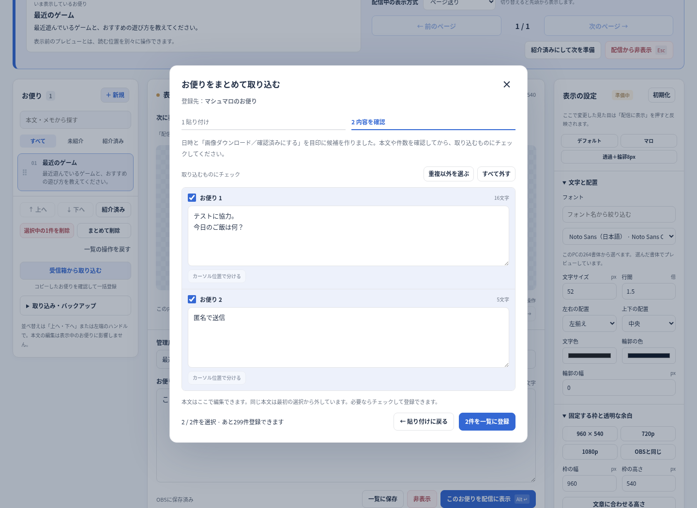

# 0.4.0: 受信箱をコピーし、確認して一括登録する

2026-10-11。自分で開いたマシュマロの受信箱をコピーし、jp-lettersへ貼り付けて、お便りごとの候補を確認してからOBSに保存する機能を追加した。[URL取り込みの調査](research-url-import-2026-10-11.md)から採用した、追加の取得通信をしない方式である。

## 使い方

1. マシュマロで **「受信箱 → もらったメッセージ → 未確認」** を開く。本文をクリックすると個別カードと回答欄へ移動するため、一覧のままにする。
2. 一覧の外の灰色の余白をクリックする。Macは **⌘A → ⌘C**、Windowsは **Ctrl＋A → Ctrl＋C** でページ全体をコピーする。
3. jp-lettersの一覧にある **「受信箱から取り込む」** を押し、貼り付けて **「内容を確認」** へ進む。
4. 本文・改行・件数を確認し、必要な候補にチェックする。**「重複以外を選ぶ」** でまとめて選ぶこともできる。**「○件を一覧に登録」** を押すとOBSへ保存し、保存が完了してから確認画面を閉じる。

確認画面で本文を編集できる。原文の区切りを判別できなければ、1件の未選択の候補として残す。不要な部分を編集し、本文内で分けたい位置をクリックして **「カーソル位置で分ける」** を押せる。

一覧やコピーの中に同じ本文があれば、最初の選択から外す。必要なら自分で選択できる。登録した候補は **「一覧の操作を戻す」1回** でまとめて戻せる。配信中の本文と表示設定は保つ。

確認中の候補は保存前の作業であり、ブラウザを閉じると消える。保存が必要なときは一覧に登録して「OBSに保存済み」を確認する。確認画面のEsc・キャンセルでは登録しない。



## マシュマロの仕組みと、確認したコピー形式

公開されている個別メッセージページの本文は、画像だけではなくHTMLの文字として存在する。しかし、個別ページの `.message-card__text` が受信箱の一覧にも存在するとは限らない。また、公開カードの本文部分を通常のChromiumでコピーする検証では、元のクラス名や `data-*` 属性がコピーに残らなかった。

最初の試作はこのクラス名を前提にしていた。利用者から、コピーの案内が曖昧だとの指摘と、受信箱・個別カードの画像が届いたため、解析方法と案内を修正した。

利用者が **Safariの日本語の未確認一覧から実際にコピーした2件のテキスト** には、次の順序があった。

```text
1分未満前
テストに協力。
今日のご飯は何？

画像ダウンロード
|

確認済みにする
5分前
匿名で送信

画像ダウンロード
|

確認済みにする
```

ページ全体には運営のお知らせやナビゲーション、フッターも入る。この[実際のサンプル](../tests/fixtures/marshmallow-inbox-safari-ja.txt)を検証へ加え、日時と操作欄で2件に分け、本文と改行を残せることを確認した。文字列から区切りを推定した候補は未選択で並べ、確認後に選んでもらう。

日時が本文にも出て区切りが曖昧な場合や、最後のお便りを途中までコピーした場合は、原文を1件として残す。判別できなかった受信箱を、本文内の `---` だけで自動分割しない。区切った本文を使うときは、貼り付ける内容を **「本文を --- または /// で区切ったもの」** へ切り替える。

貼り付けにHTMLが含まれる場合は、個別カードの本文欄、または正規ドメインの `/messages/<UUID>` へのリンクから候補を作る補助処理もある。画像・回答・別サイトへのリンクは対象にしない。HTMLは非表示の `template` の中で文字だけを読む。元のHTMLを操作画面へ表示せず、画像やスクリプトを読み込まない。

この機能はマシュマロにログインせず、Cookieや認証情報を受け取らず、受信箱の自動取得・URLの取得をしない。マシュマロのHTML・JS・CSSや、第三者製品のコードを配布物に含めていない。

## 検証

実Linux libobs 30.2.3＋OBS LuaJITと実Chromiumで、Web28項目、OBS Lua6項目、フォント制限5通りが通過した。

- Safariから提供された実テキストで、LF・CRLFの両方からちょうど2件を抽出する。1件目の改行、お知らせ・日時・操作欄・フッターの除外を確認する。
- その2件を確認画面で選び、正しいOBSソースへ保存し、1回の取り消しで戻す。表示中のお便りは変えない。
- 再現DOMを通常のChromiumでコピー・貼り付けし、クラスや `data-*` 属性を前提にせず、個別メッセージへのリンクから本文を取り出す。
- HTML内の絵文字と改行を残す。貼り付けに画像・スクリプト・iframeがあっても、実行や外部への通信が起きない。
- 候補の編集・チェック・分割・取り消し、重複、確認中の別ソースへの切り替えを検証する。空の本文・URLのみ・長すぎる本文は修正するまで登録できない。
- 判別不能・曖昧・途中までのコピーを黙って捨てない。1MB超、500件超の確認を拒否し、貼り付けた内容を残す。
- [幅390pxの確認画面](images/inbox-import-narrow-v0.4.0.png)が収まり、従来のページ・スクロール・フォント・配色・バックアップ・OBS保存と復元も確認した。
- スクリプト削除、再追加、3回の再読み込みで、0.3.1のクラッシュ対策と子ソース・ホットキーの後始末を確認する。

検証した製品ファイルと配布ZIPのSHA-256を照合した。[機械可読の結果](validation-v0.4.0.json)。

**実際のSafariのコピー内容を処理した検証と、Safari上で操作画面を動かした検証は区別する。** 今回の環境ではMac・WindowsのOBS実機とSafari上の操作画面を動かしていない。ネイティブ側の子ブラウザはテスト用の描画ソースで代用し、HTMLは別の実Chromiumで検証した。Windowsの実際のコピー形式、確認済みの一覧、別の言語、伏字などの表示は未確認。[#9](https://github.com/hekiruligames/jp-letters-lua/issues/9)で実機検証を継続する。

## 更新

OBSを終了して、既存フォルダの `jp-letters.lua` と `runtime`・`web` を新しいZIPのファイルでまとめて上書きする。その後、OBSを起動してお便りの操作画面を開き直す。[詳しい手順](../letters/README.md#旧版から更新する)。
